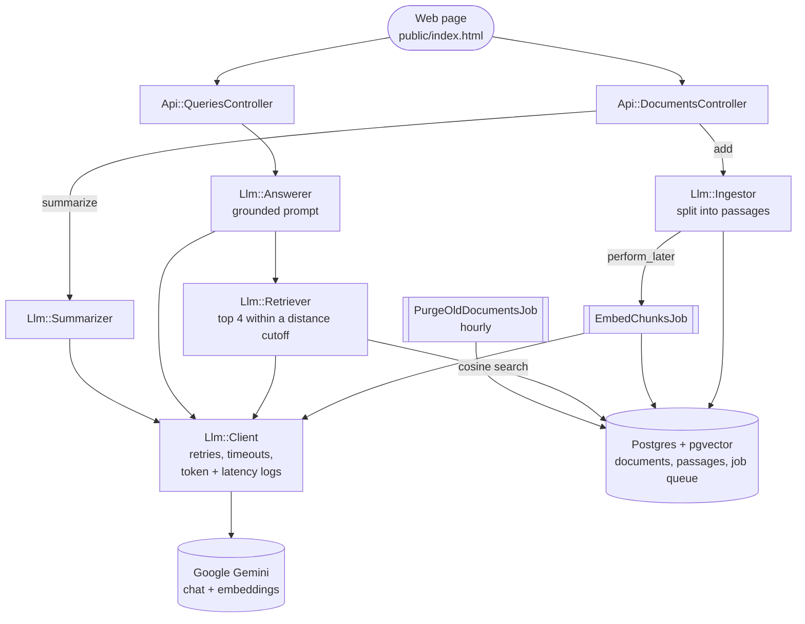

# DocQA

Ask questions about a document and get answers drawn only from its text, with
the exact passages each answer came from highlighted in place.

**Live demo:** https://docqa-fkc4.onrender.com
*(Free hosting: the first request after 15 idle minutes takes about a minute to wake the app.)*

DocQA is a Rails API with a small web page in front. You paste a document; it's
split into passages, each passage is turned into a vector embedding and stored
in Postgres with pgvector. When you ask a question, the most similar passages
are retrieved and handed to the model with instructions to answer from them
alone. If no passage is close enough, the model isn't called at all and the
answer says the document doesn't cover it.

## What it does

- **Ask** a question about a document. The answer comes back with its source
  passages, which are highlighted and numbered in the document text.
- **Refuse** questions the document can't answer, without calling the model.
- **Summarize** a document into an overview and key points.
- **Index in the background**: adding a document returns immediately, and the
  page shows indexing progress.

## Architecture



Everything stateful lives in one Postgres database: documents, passage
vectors, and the background job queue. Every model call goes through one
class, `Llm::Client`.

## Stack

- **Ruby on Rails 8.1** (API mode), Ruby 3.2
- **PostgreSQL + pgvector** through the `neighbor` gem, with an HNSW index for
  cosine-distance search
- **Google Gemini**: `gemini-2.5-flash` for answers and summaries,
  `gemini-embedding-001` for embeddings (768 dimensions). One API key, called
  over plain HTTP; no SDK gem.
- **Solid Queue** for background jobs, storing its queue in the same Postgres
  database, so there's no Redis
- **RSpec**, with the model stubbed so tests are deterministic and free
- **Hosting:** Render (free web service) and Neon (free Postgres)

## Running locally

You need Ruby 3.2 and PostgreSQL with the pgvector extension
(`brew install pgvector`, or `apt install postgresql-16-pgvector`).

```bash
bundle install
bin/rails credentials:edit      # add your keys, see Configuration below
bin/rails db:prepare
bin/rails server
```

Background jobs (indexing) need a worker. Either run `bin/jobs` in a second
terminal, or start the server with the worker inside it:

```bash
SOLID_QUEUE_IN_PUMA=1 bin/rails server
```

Open http://localhost:3000, click **Use a sample returns policy**, add it, and
ask a question. To exercise the whole API from the command line:

```bash
bin/smoke_test.sh               # health → add → wait for indexing → ask → summarize
```

Get a free Gemini API key (no card needed) at https://aistudio.google.com/apikey.

## Configuration

Settings live in Rails credentials (`bin/rails credentials:edit`). Only
`gemini.api_key` is required; everything else shows its default.

```yaml
gemini:
  api_key: AIza...                      # required
  chat_model: gemini-2.5-flash
  embeddings_model: gemini-embedding-001
  embeddings_dims: 768                  # must match vector(N) in the migration
  thinking_budget: 0                    # false = don't send the setting

retrieval:
  max_distance: 0.6                     # how close a passage must be; false = no cutoff

limits:
  max_question_chars: 1000
  max_document_chars: 200000
  summary_max_input_chars: 30000
  questions_per_minute: 10              # per visitor
  questions_per_day: 500                # whole site
  documents_per_hour: 5                 # per visitor
  documents_per_day: 50                 # whole site
  summaries_per_hour: 10                # per visitor
  document_ttl_hours: 24                # documents are deleted after this

database:
  url: postgresql://...                 # production only
  local_username: you                   # development and test
  local_password: ...
```

Each setting can also come from an environment variable (`LLM_API_KEY`,
`LLM_CHAT_MODEL`, `RETRIEVAL_MAX_DISTANCE`, `DB_USERNAME`, `DB_PASSWORD`, ...),
used only when credentials don't have it. CI relies on this, because it has
no master key. The lookup lives in `lib/app_setting.rb`.

A few settings must stay environment variables because Puma reads them before
Rails loads, or the host sets them: `PORT`, `RAILS_ENV`, `RAILS_MAX_THREADS`,
`DB_POOL`, `WEB_CONCURRENCY`, `SOLID_QUEUE_IN_PUMA` and `RAILS_MASTER_KEY`.

## API

The web page uses these endpoints, and you can call them directly.

### Add a document
```
POST /api/documents
{ "title": "Refund Policy", "content": "..." }
-> 202 { "id": 1, "status": "processing", "chunks": 3 }
-> 422 content blank or too long
-> 429 rate limited
```

### Check indexing progress
```
GET /api/documents/1
-> 200 { "id": 1, "title": "...", "content": "...", "status": "processing",
         "chunks": 3, "embedded_chunks": 2 }
```
`status` goes from `processing` to `ready`, or to `failed` if embedding keeps
failing after the job's retries.

### Ask a question
```
POST /api/queries
{ "document_id": 1, "question": "How long do refunds take?" }
-> 200 {
     "answer": "Refunds are processed within 5-7 business days.",
     "sources": [ { "chunk_id": 12, "excerpt": "first 200 chars...", "text": "full passage" } ],
     "tokens_used": 842
   }
-> 404 unknown document
-> 409 { "error": "document_not_ready", "status": "processing" }
-> 422 question blank or too long
-> 429 rate limited
-> 502 the model failed after retries
```
If no passage is close enough to the question, `answer` is a fixed "I don't
have enough information..." with empty `sources` and `tokens_used: 0`. The
model isn't called.

### Summarize
```
POST /api/documents/1/summary
-> 200 { "summary": { "overview": "...", "key_points": ["...", "..."] },
         "truncated": false, "tokens_used": 310 }
```
Long documents are summarized from their opening portion, and `truncated` is
`true`.

### Health check
```
GET /health
-> 200 { "status": "ok" }
```

## How it handles failure

| Risk | What the app does |
|---|---|
| Gemini rate limits, server errors, timeouts | Retries with exponential backoff plus random jitter, so many requests don't retry at the same instant. Errors that won't fix themselves (bad requests) aren't retried. |
| Confident answers to off-topic questions | Passages beyond a cosine-distance cutoff are dropped. If none are left, the app refuses without calling the model. The prompt also forbids outside knowledge, as a second layer. |
| The model returns nothing | Gemini 2.5's "thinking" tokens count against the output limit and can use all of it, so thinking is off by default. An empty or blocked reply raises an error naming Gemini's reason instead of returning blank text. |
| Malformed summaries | Gemini's JSON mode, then a parser that tolerates wrappers, renamed keys and stray text. If no summary can be found, it reports an error rather than an empty box. |
| Indexing fails part-way | Adding a document is one transaction. The job resumes from passages that still lack embeddings, and marks the document `failed` after its last retry instead of leaving it `processing` forever. |
| Wrong-sized vectors | The client rejects any embedding whose length differs from the configured dimension before it's stored. |
| A public demo using up the free quota | Per-visitor and site-wide rate limits on everything that calls Gemini, a 200,000-character document cap, and documents deleted after 24 hours. |

Each model call logs one line with tokens and latency:

```
[Llm::Client] op=chat model=gemini-2.5-flash ms=812 tokens_in=412 tokens_out=38 tokens_total=450
[Llm::Retriever] document=1 kept=2/4 distances=0.284,0.391,0.672,0.705
```

To see the safeguards work:

```bash
bin/rails llm:verify_retry      # a fake provider fails, retries with backoff, gives up (no key needed)
bin/rails llm:ping              # one real chat and embedding call, with the log lines
```

**Tuning the relevance cutoff:** 0.6 is a starting point. Ask a few questions
the document answers and a few it doesn't, read the `[Llm::Retriever]`
distances in the log, and set `retrieval.max_distance` between the two groups.

## Design decisions

- **Retrieval instead of fine-tuning or pasting whole documents.** The value is
  grounding: answers come with the passages they used, a document can be
  replaced instantly, and the app can refuse when nothing relevant exists.
- **pgvector instead of a dedicated vector database.** One database to run. The
  retriever has a single public method, so moving to Pinecone or Qdrant later
  would change one class.
- **Background embedding.** A long document means many API calls. Doing them
  in the request would make adding a document slow and fragile.
- **One client class for every model call.** Timeouts, retries and logging
  live in one place, and provider errors are turned into a small set of
  retryable and non-retryable errors, so nothing else depends on Gemini's
  details.
- **Passages break at word boundaries,** around 800 characters with 100
  characters of overlap, so no word is split and each passage can be located
  exactly in the document for highlighting.
- **Stub the model in tests.** What's worth testing is this app's logic
  (retrieval, prompting, parsing, retries), not Google's model, and stubbing
  makes the suite fast, deterministic and free to run in CI.

## Testing

```bash
RAILS_ENV=test bin/rails db:prepare
bundle exec rspec
```

The suite covers the client's retries, jitter, response parsing and error
mapping; retrieval against real pgvector queries; chunking; the summarizer's
parsing fallbacks; the embedding and purge jobs; rate limits; and every
endpoint's status codes. The workflow in `.github/workflows/ci.yml` runs it on
every push against Postgres with pgvector.

## Deploying (Render + Neon, $0)

1. **Database:** create a free Neon project, run `CREATE EXTENSION IF NOT EXISTS vector;`
   in its SQL editor, and copy the **direct** (non-pooled) connection string
   into credentials as `database.url`.
2. **Commit** `Gemfile.lock`, `db/schema.rb` and `config/database.yml`.
   Never commit `config/master.key`; `.dockerignore` keeps it out of the image too.
3. **Render:** New → Blueprint, choose the repo. `render.yaml` defines the
   service. When asked, paste the contents of `config/master.key` as
   `RAILS_MASTER_KEY`.
4. Deploy. `bin/docker-start` runs `db:prepare`, then starts Puma with the job
   worker inside it.

The service needs these environment variables (`render.yaml` sets them):

| Variable | Value | Why |
|---|---|---|
| `RAILS_MASTER_KEY` | contents of `config/master.key` | Decrypts credentials |
| `SOLID_QUEUE_IN_PUMA` | `1` | Runs the job worker inside the web process; Render's free tier has no separate workers |
| `WEB_CONCURRENCY` | `0` | Runs Puma as one process (see below) |
| `DB_POOL` | `5` | Solid Queue needs its worker threads plus 2 connections |

### Problems hit on the way to production

Worth knowing if you deploy a Rails 8 app the same way:

- **Jobs were queued but never ran.** Render sets `WEB_CONCURRENCY=1` by
  default, which puts Puma in cluster mode. The Solid Queue plugin starts from
  the cluster's parent process, which never loads Rails, so it crashed with
  `uninitialized constant SolidQueue` while the web pages kept working.
  `WEB_CONCURRENCY=0` (single process) fixed it, and saves memory on a 512 MB
  instance.
- **Boot failed asking for libvips.** Rails 8.1.3.1 (a security release) makes
  Active Storage refuse to boot without libvips. This app handles no uploads,
  so Active Storage, Action Mailbox and Action Text are not loaded.
- **Boot failed on missing `cable`, `cache` and `queue` databases.** Rails 8
  sets production up with four databases. This app uses one: Solid Queue's
  tables live in the main database, Action Cable uses the `async` adapter, and
  the cache is in memory.
- **The start command failed with "not found".** Render passed the quotes in an
  inline `sh -c "..."` command through literally. The start steps now live in
  `bin/docker-start`.

Free-tier behaviour: the app sleeps after 15 idle minutes, and Neon suspends
after 5. Rate-limit counts are kept in memory, so they reset when the app
restarts.

## Privacy and cost

- This is a public demo. Anyone with a document's link (`/?doc=3`) can open it,
  and documents are deleted after 24 hours. Use public or made-up text.
- On Gemini's free tier, Google may use inputs to improve its models.
- The free tier can't be billed; hitting its quota returns errors, which the app
  reports as "model unavailable". If you enable billing, set a budget alert in
  Google Cloud.

## What I'd add next

- Questions across several documents at once
- Unguessable document links instead of sequential numbers
- Sentence-aware chunking
- Batch embedding calls to make indexing long documents faster
- A shared store for rate-limit counts, so they survive restarts
